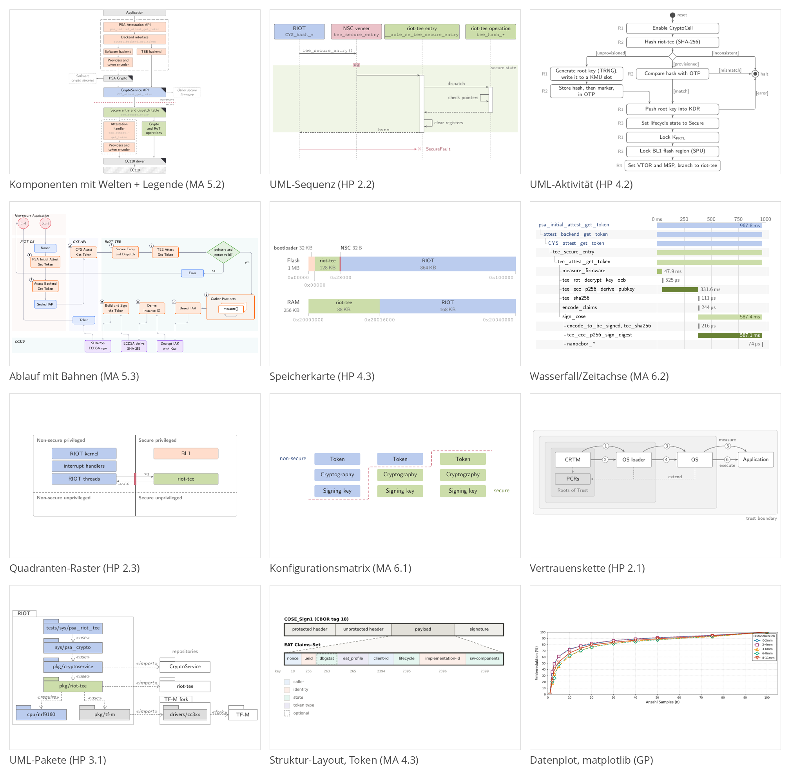
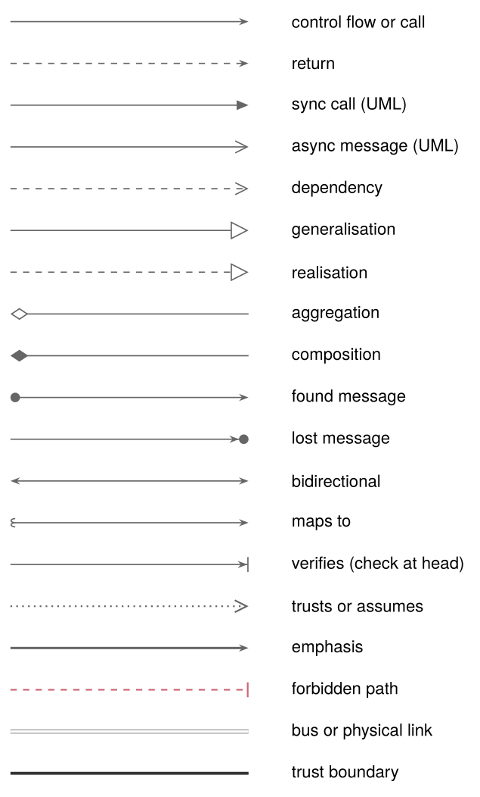
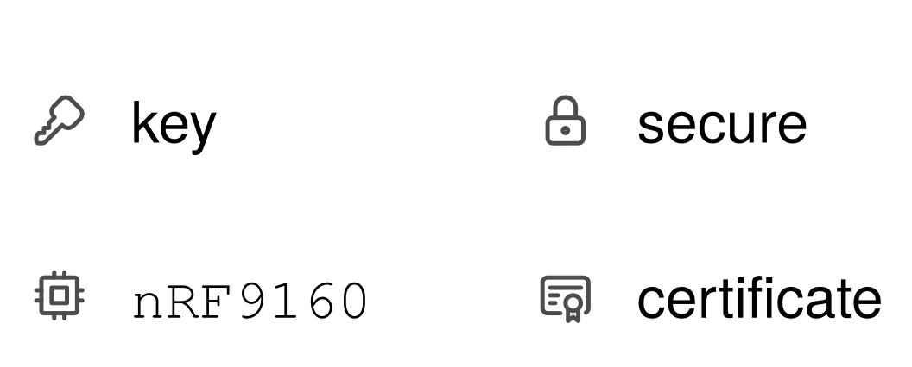
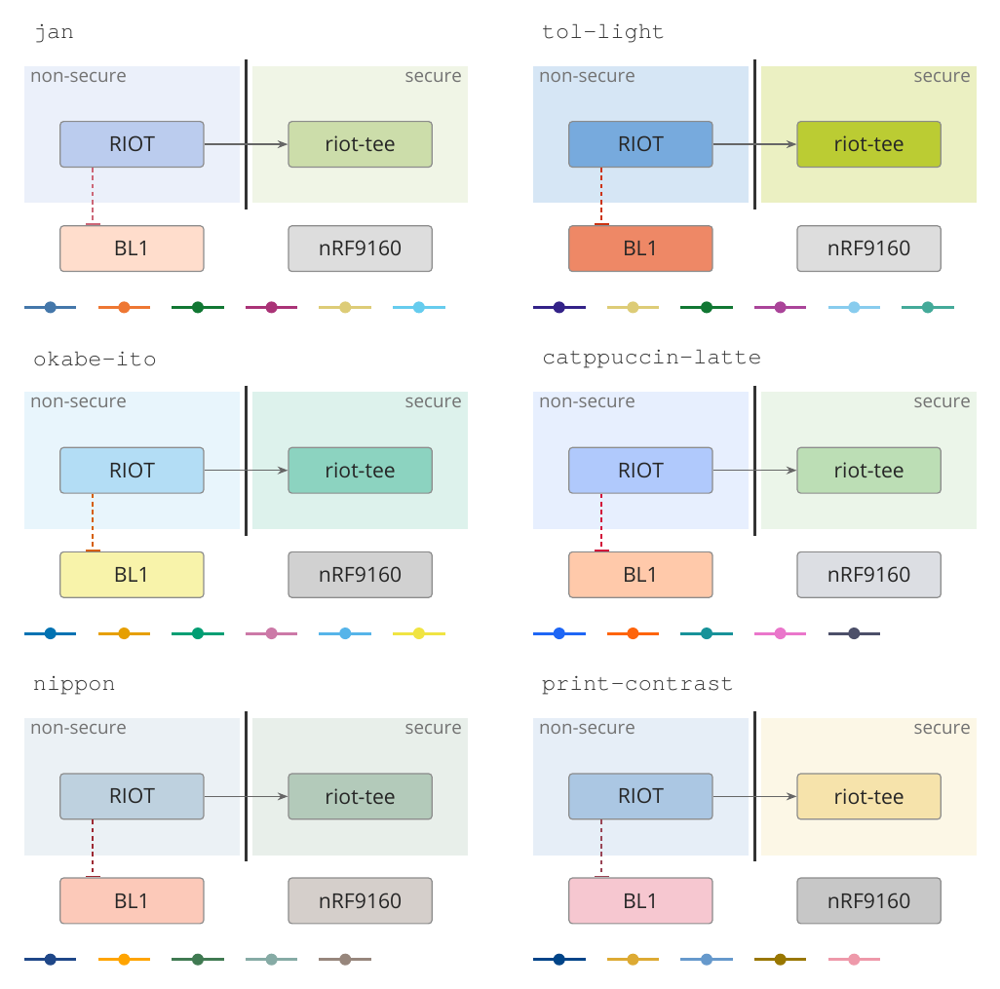
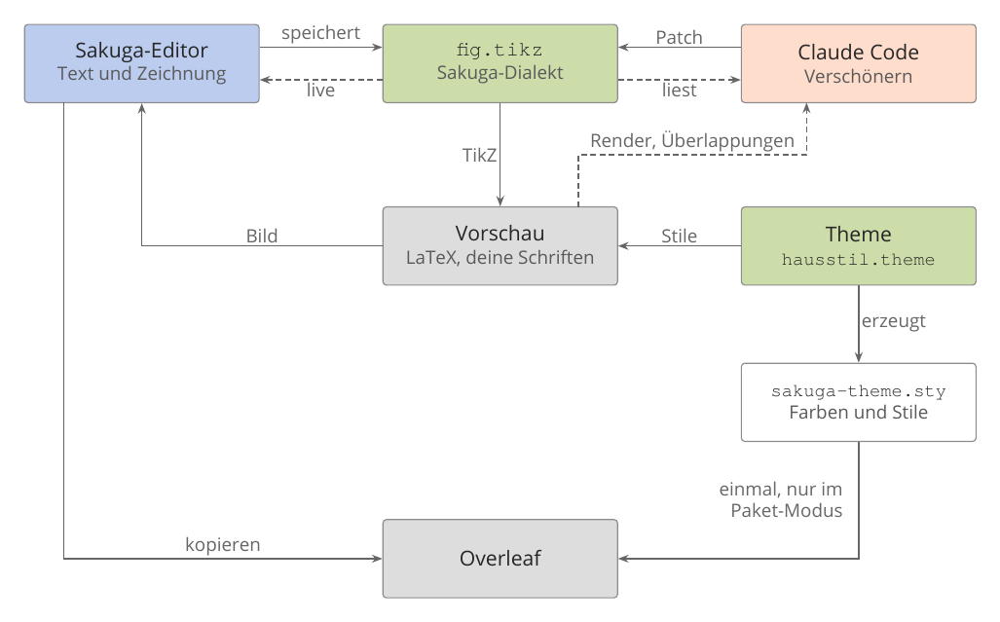

# Sakuga: Recherche und Konzept

Stand 19. Oktober 2026, überarbeitet nach deinen Antworten auf Abschnitt 9. Grundlage sind deine drei Arbeiten (Hauptprojekt 14, Masterarbeit 21, Grundprojekt Revision 2) und eine Recherche zu Diagrammtypen, Notation, Farbthemes, Bedienung und Technik.

Deine Abbildungen im Hauptprojekt und in der Masterarbeit sehen inzwischen einheitlich aus, aber dieser Eindruck entsteht trotz der Dateien, nicht durch sie. Jede Abbildung definiert ihre Farben selbst, derselbe Kastenstil steht unter sieben Namen in sieben Dateien, und jede Koordinate ist von Hand gesetzt. Eine kleine Änderung, etwa einen Kasten zu verschieben, berührt drei bis sechs Zeilen und kostet in deinem jetzigen Ablauf eine weitere Runde mit Claude. Sakuga sollte deshalb vor allem zwei Dinge leisten. Erstens einen Hausstil, der einmal definiert ist und den jede Abbildung nur über Rollen wie „secure“ oder „Aufruf“ benutzt. Zweitens eine Abbildungsdatei in einem festen TikZ-Dialekt, die links als Text und daneben als Zeichnung erscheint. Du skizzierst, Claude Code verschönert, eine Layout-Engine setzt die Koordinaten, und der Text ist zugleich das, was du nach Overleaf kopierst oder von dort wieder einfügst. Die folgenden Abschnitte begründen beides aus deinen Arbeiten und aus der Recherche und schlagen einen Umfang für die erste Version vor.

## 1 Was deine drei Arbeiten zeigen

Im Hauptprojekt stehen neun Abbildungen, jede als eigene TikZ-Datei, in acht verschiedenen Diagrammtypen. In der Masterarbeit erscheinen sechzehn Abbildungen: zehn TikZ-Abbildungen im Hausstil, drei schwarz-weiße draw.io-Nachzeichnungen aus RFC 9334, zwei Matplotlib-SVGs und ein Listing. Das Grundprojekt bindet zwanzig Bilder ein, davon zehn Datenplots aus Matplotlib, dazu Fotos, Oszilloskop-Screenshots und einen KiCad-Schaltplan. Abbildung 1 zeigt je ein Beispiel der wichtigsten Typen.

| Typ | Wo | Was dahinter steckt |
|---|---|---|
| Komponenten- oder Schichtendiagramm mit Welten | HP 2.4, 3.1; MA 4.1, 4.2, 5.2, 5.5 | wer wen aufruft, in welcher Welt |
| Speicherkarte | HP 4.3; MA 5.1, 5.4 | Adressbereiche mit Größen |
| Ablauf: Aktivität, Bahnen, Prüfleiter | HP 4.2; MA 5.3, 5.6 | Schritte mit Verzweigungen |
| Rollendiagramm (RFC-Nachzeichnung) | MA 2.1 bis 2.3 | Akteure und ihre Nachrichten |
| Vertrauenskette mit verschachtelten Regionen | HP 2.1, 4.1 | Stufen und Enthaltensein |
| Matrix oder Raster | HP 2.3; MA 6.1 | Zuordnung zu zwei Kategorien |
| Struktur-Layout (Token, Array zu Map) | MA 4.3, 4.4 | verschachtelte Felder |
| UML-Sequenzdiagramm | HP 2.2 | geordnete Nachrichten |
| Wasserfall oder Zeitachse | MA 6.2 | Aufrufe mit Beginn und Dauer |
| Datenfluss vorher und nachher | HP 3.2 | Werte, die durch Dateien wandern |
| Datenplots (Messkurve mit Fit, Fehler über Parameter, Small Multiples) | GP, zehn Stück; MA, zwei ungenutzte | Messreihen aus CSV |

Kein Typ kommt häufiger als sechsmal vor, und allein das Hauptprojekt braucht acht verschiedene. Ein Werkzeug mit nur einer freien Zeichenfläche hilft dir deshalb nur zur Hälfte. Ein Teil der Typen ist ein Graph aus Knoten und Kanten, dessen Lage eine Layout-Engine bestimmen kann: Komponenten, Abläufe, Pakete. Bei den anderen folgt die Lage aus Daten. Die Breite eines Speichersegments ergibt sich aus seiner Größe, die Zeile einer Nachricht aus ihrer Reihenfolge, die Länge eines Wasserfall-Balkens aus der gemessenen Dauer. Für diese zweite Familie braucht Sakuga Vorlagen, die aus einer Tabelle zeichnen.

Wie die Abbildungen entstanden sind, ist für das Werkzeug ebenso wichtig wie ihr Typ. Alle neun aktiven TikZ-Dateien des Hauptprojekts beginnen mit dem Kommentar „AI draft figure (Claude)“. Ihre Vorgänger in `diagrams/` sind Screenshots fremder Abbildungen, eine draw.io-Skizze (das eingebettete draw.io-XML im PNG belegt das) und ein Bild im Mermaid-Stil. Dein Ablauf ist also schon heute: eine Idee oder grobe Skizze, dann zeichnet Claude die TikZ-Fassung, dann folgen Korrekturrunden. Sakuga muss diesen Ablauf nicht ersetzen. Es soll die zwei teuren Stellen darin billiger machen: die Idee präzise zu übergeben und kleine Korrekturen selbst mit der Maus zu erledigen, statt sie in einen weiteren Prompt zu fassen. In der Masterarbeit fehlt die Markierung, dort lässt sich die Herkunft aus den Dateien nicht ablesen.

Der Code zeigt, wo die Zeit hingeht. Fast alle Abbildungen setzen absolute Koordinaten in Millimetern, im Hauptprojekt ausnahmslos. Die Bibliothek `positioning` ist zwar geladen, wird aber in keiner Abbildung des Hauptprojekts benutzt. Zusammengehörige Werte stehen an mehreren Stellen: Die Grenze zwischen den Welten liegt in `secure_firmware.tex` an vier Stellen bei x = 82, und die Breiten der Speichersegmente sind von Hand aus den Größen ausgerechnet. Der Stil wandert per Kopie von Datei zu Datei. Im Hauptprojekt ist die Palette in sieben von neun Dateien neu definiert, der Kastenstil existiert unter sieben Namen, und der Pfeilstil steht wörtlich in sechs Dateien. In der Masterarbeit leben vier Farbgenerationen nebeneinander, und dieselbe Farbe `CCDDAA` heißt je nach Datei `palGreen`, `memSecure`, `fwSecure` oder `cfgS`. Die Bedeutung der Farben ist dabei erstaunlich stabil geblieben: Blau steht überall für die nicht sichere Welt, Grün für die sichere, Rosa für Grenze oder Fehler. Diese Stabilität ist das Kapital, auf dem Sakugas Themes aufbauen können.

Den Look mit Pastellfarben und Legende, den du beschrieben hast, zeigt am deutlichsten Abbildung 5.2 der Masterarbeit (`fig_components`). Die Bedeutung liegt dort in den Füllungen, nicht in den Rahmen. Blau, Grün, Pfirsich und Grau füllen die Kästen, die Rahmen sind neutral grau, und Rosa erscheint nur als gestrichelte Weltgrenze. Die Legende steht unten links in zwei Spalten, mit Farbfeldern im Stil der Kästen und Linienmustern für die Rahmenarten. Du hast bestätigt, dass du diese Abbildung meinst; sie ist die Referenz für das Theme `jan`. Auffällig ist, dass das Hauptprojekt fast ohne Legende auskommt: Nur eine von neun Abbildungen hat eine, die übrigen beschriften direkt. Sakuga sollte beides können und die Legende aus den Rollen erzeugen, die eine Abbildung tatsächlich benutzt.

Das Grundprojekt zeigt die Probleme einer anderen Art von Abbildung. Seine zehn Datenplots sind Matplotlib-Bitmaps in Standardschrift mit sechs voneinander unabhängigen Farbschemata. Sie wurden mit 8 bis 16 Zoll Breite erzeugt und mit 45 bis 95 Prozent der Textbreite eingebunden, sodass die effektive Schriftgröße von Bild zu Bild schwankt. Die Daten selbst sind klein, höchstens etwa 120 Punkte pro Reihe, und ließen sich alle aus CSV mit pgfplots zeichnen; Fits und RMSE blieben dabei in Python. Nebenbei hat die Analyse zwei inhaltliche Stellen gefunden. Die 100 Prozent Fehlerreduktion bei n = 100 sind ein Artefakt, weil dort 100 aus 100 Werten ohne Zurücklegen gezogen werden. Außerdem passt die Aussage, fünf Samples halbierten den Fehler, nicht ganz zum Plot, der bei n = 5 je nach Distanzbereich 45 bis 61 Prozent zeigt (am Bild abgelesen, nicht nachgerechnet).

## 2 Welcher Diagrammtyp für welche Daten

Zur Wahl von Datenplots gibt es belastbare Forschung, zu Strukturdiagrammen kaum. Cleveland und McGill haben 1984 gemessen, dass Leser Werte am genauesten über die Position auf einer gemeinsamen Skala ablesen und schlechter über Länge, Winkel und Fläche. Daraus folgen die bekannten Regeln: Balken beginnen bei null, und Tortendiagramme taugen selten. Für Strukturdiagramme gibt es nur Häufigkeitsstudien aus anderen Fächern. Viziometrics hat 4,8 Millionen Abbildungen aus PubMed Central klassifiziert; nach dem Zerlegen zusammengesetzter Abbildungen waren 35 Prozent Plots und 20 Prozent Diagramme. Eine vergleichbare Zählung für Systems-, Embedded- oder Security-Konferenzen hat die Recherche nicht gefunden. Die folgende Tabelle stützt sich deshalb auf Konventionen und auf deine Arbeiten, nicht auf gezählte Häufigkeiten. Die Spalte „Sakuga“ schlägt vor, wann eine Vorlage dafür kommt; Datenplots bleiben nach deiner Entscheidung in Python.

| Was du zeigen willst | Diagrammtyp | Nicht, wenn … | LaTeX-Weg | Sakuga |
|---|---|---|---|---|
| wer mit wem in welcher Reihenfolge interagiert, wenige Beteiligte | UML-Sequenzdiagramm | es keine zeitliche Ordnung gibt | eigene Vorlage; `pgf-umlsd` 0.7 | v1 |
| welche Teile es gibt und wer wen aufruft | Komponenten- oder Blockdiagramm | die Reihenfolge zählt; mehr als etwa 12 Kästen | `positioning`, `fit`, Layout per ELK | v1 |
| welche Komponente in welcher Domäne liegt und welche Übergänge erlaubt sind | Vertrauensgrenzen-Diagramm (Regionen und Grenzlinie) | keine Sicherheitsaussage gemacht wird | getönte Regionen, Grenzlinie | v1 |
| Adressbereiche mit Größen und Attributen | Speicherkarte | — | proportional aus einer Tabelle | v1 |
| ein Ablauf mit Verzweigungen | Aktivitätsdiagramm oder Flussdiagramm | nur Daten wandern (dann Datenfluss) | `shapes.geometric` | v2 |
| Modi einer Komponente und ihre Übergänge | Zustandsautomat | es nur eine Abfolge gibt | `automata` | v2 |
| Dauer und Überlappung von Aufrufen | Wasserfall oder Gantt | es Tausende Ereignisse sind (dann Flame Graph) | eigene Vorlage; `pgfgantt` 5.0a | v2 |
| Zuordnung zu zwei Kategorien je Zelle | Matrix oder Raster, oft besser als Tabelle | die Zelle eine Zahl hält (dann Heatmap) | `matrix of nodes` | v2 |
| Byteformat einer Nachricht oder Struktur | Byte-Feld-Layout | es um Beziehungen der Felder geht | `bytefield` 2.9 | v2 |
| Bits eines Registers | Bitfeld | die Länge variabel ist | `register` 2.0 | später |
| Bedrohungen je Element und Fluss | Datenflussdiagramm für Threat Modeling | — | Formstile, Grenzlinie | später |
| strikte Hierarchie, etwa ein Angriffsbaum | Baum | es Querverbindungen gibt | `forest` | später |
| Signale über der Zeit | Zeitdiagramm | nur die Nachrichtenfolge zählt | `tikz-timing` | später |
| wenige Kategorien mit je einem Wert gegen eine Basis | Balkendiagramm ab null | der Wert ein Mittel einer schiefen Verteilung ohne Streuung ist | `pgfplots` `ybar` | Python |
| Trend über einer geordneten Größe (Last, Payload) | Liniendiagramm, bei großem Bereich logarithmisch | mehr als etwa fünf Linien (dann Small Multiples) | `pgfplots` | Python |
| Zusammenhang zweier Messgrößen mit Fit | Streudiagramm mit Fitlinie, Residuen darunter | sich die Punkte stark überdecken | `pgfplots` `only marks` | Python |
| Verteilung, etwa von Latenzen | ECDF oder CCDF, Boxplot für viele Gruppen; Median plus p95/p99 angeben | — (nie als Balken der Mittelwerte) | `pgfplots` | Python |
| Messunsicherheit | Fehlerbalken oder Band; bei weniger als etwa fünf Läufen die Punkte selbst | — | `error bars`, `fill between` | Python |
| derselbe Plot für viele Konfigurationen | Small Multiples | jedes Feld eine eigene Skala braucht | `groupplots` | Python |
| ein Wert pro Zelle zweier Dimensionen | Heatmap mit Zahlen in den Zellen | die Achsen ungeordnet sind | `matrix plot*` | Python |
| Anteil am Ganzen | sortierter Balken statt Torte | — | `pgfplots` | Python |

Die Versionsnummern stammen aus der CTAN-Paketdatenbank vom 19. Oktober 2026. Für Sakuga folgt aus der Tabelle eine Zweiteilung. Strukturdiagramme sind Knoten und Kanten, deren Lage eine Engine berechnet. Diagramme mit Datenachse (Speicherkarte, Wasserfall, Sequenz, alle Plots) sind Vorlagen mit einer Datentabelle, aus der die Lage folgt. Für Plots nennt die Tabelle pgfplots nur als LaTeX-Weg; gezeichnet werden sie weiter in Python.

## 3 Präzise darstellen: Pfeile, Symbole, Icons, Legenden

Die gängigste Grundlage für die Gestaltung von Notationen ist Moodys „Physics of Notations“ (IEEE TSE, 2009). Moody fordert unter anderem, dass jedes Symbol genau eine Bedeutung hat, dass sich Symbole verschiedener Bedeutung deutlich unterscheiden und dass Text jedes Symbol begleitet. Der Artikel selbst ist hinter einer Bezahlschranke, seine Prinzipien sind hier über Arbeiten bestätigt, die sie anwenden. Für ein Werkzeug lassen sie sich in prüfbare Regeln übersetzen. Ein Pfeilstil, eine Linienart, eine Füllfarbe und ein Icon haben im ganzen Dokument je genau eine Bedeutung. Zwei Kantenarten unterscheiden sich in mindestens zwei visuellen Merkmalen, etwa Spitze und Strichelung, und nie nur in der Farbe, weil ein Graustufendruck die Farbe verliert. Ein Dokument kommt mit höchstens etwa sechs Knotenformen und sechs Kantenarten aus. Jeder Knoten trägt ein Label; Icon und Farbe ergänzen es nur.

Die wichtigste Folge für Sakuga betrifft die Kanten. Eine Kante bekommt keinen frei gewählten Stil, sondern eine Art aus einer festen Liste: Aufruf, Rückgabe, Abhängigkeit, misst, verboten. Das Theme bestimmt, wie jede Art aussieht. Die Farben funktionieren genauso, wie Abschnitt 4 zeigt. Dadurch kann eine Abbildung gar nicht vom Hausstil abweichen, und die Legende entsteht aus den Arten, die vorkommen. Abbildung 2 zeigt das Vokabular, das die Recherche vorschlägt, kompiliert mit den Strichstärken deines Hausstils.

| Herkunft | Arten |
|---|---|
| UML 2, über Sparx- und IBM-Dokumentation bestätigt (die Spezifikation selbst war zu groß zum Abrufen) | synchroner Aufruf (gefüllte Spitze), asynchrone Nachricht (offene Spitze), Rückgabe (gestrichelt), Found/Lost (Punkt), Generalisierung, Realisierung, Aggregation, Komposition, Abhängigkeit |
| dein Hausstil | Aufruf (Stealth, `black!60`, 0,6 pt), Rückgabe gestrichelt, Vertrauensgrenze (`black!80`, 1,4 pt) |
| eigene Festlegung ohne Standard | „vertraut“ (gepunktet), „verifiziert“ (Querbalken an der Spitze), „verboten“ (Rosa gestrichelt mit Querbalken), Bus (Doppellinie) |

Für die Knoten gilt dasselbe Prinzip über Vorlagen. Jede Vorlage bringt die Standardsymbole ihres Typs mit und keine erfundenen. Das UML-Sequenzdiagramm hat gestrichelte Lebenslinien, Aktivierungsbalken und gestrichelte Rückgaben. Das Aktivitätsdiagramm hat Startpunkt, Entscheidungsraute und Endknoten. Das Threat-Model-Datenflussdiagramm folgt dem Microsoft Threat Modeling Tool mit Prozess, Datenspeicher, externer Entität und Vertrauensgrenze. Schaltpläne wie im Grundprojekt sollte Sakuga nicht nachzeichnen, sondern `circuitikz` überlassen.

Icons helfen nach den gefundenen Studien nur zusammen mit einem Label. Ein Icon allein wird bei unbekannten Begriffen schlecht erkannt, und für TEE, Hash oder Attestierungstoken gibt es kein gelerntes Symbol. Icons gehören deshalb nur dorthin, wo eine Klasse von Dingen in einer Abbildung oft vorkommt, etwa Schlüssel oder Zertifikate. Ein Icon steht dann immer neben einem Label, ist einfarbig und hat dieselbe Strichstärke wie die anderen. Der Test dafür: Entfernt man das Icon, darf die Abbildung keine Information verlieren. Als Iconsatz empfiehlt die Recherche Tabler Icons (MIT-Lizenz, © 2020–2026 Paweł Kuna), weil seine Umrisslinien zu deinen dünnen Rahmen passen. Abbildung 3 zeigt, dass sich ein Tabler-Icon als reiner TikZ-Pfad über die Bibliothek `svg.path` einfügen lässt. Dafür muss keine Bilddatei nach Overleaf hochgeladen werden.

Für Legenden ergeben sich vier Regeln. Was in einer Abbildung höchstens zweimal vorkommt, wird direkt beschriftet, wie es das Hauptprojekt fast überall tut. Eine Legende erscheint nur für Codierungen, die nicht selbsterklärend sind, und zeigt nur Einträge, die vorkommen. Ihre Muster sind die echten Stile, weil Sakuga sie aus dem Theme zeichnet. Sie steht in allen Abbildungen eines Dokuments an derselben Stelle.

## 4 Farbthemes

Deine Palette stammt größtenteils von Paul Tol. `BBCCEE`, `CCDDAA` und `DDDDDD` sind sein Schema „pale“ aus der technischen Notiz SRON/EPS/TN/09-002 (Ausgabe 3.2, 2021, Abb. 6), `CC6677` ist „rose“ aus seinem Schema „muted“. Nur `FFDDCC` ist deine eigene Variante; Tols blasses Rot wäre `FFCCCC`. Tol hat die blassen Farben als Hintergrund für schwarzen Text entworfen und schreibt selbst, dass sie untereinander schwer zu unterscheiden sind. Deshalb brauchen Regionen in diesem Schema ein Label oder eine Legende. Seine aktuelle Webseite zeigt inzwischen ein anderes „pale“-Schema; zitieren solltest du daher die PDF-Notiz. Die Farben deiner Code-Listings sind exakt Catppuccin Latte. Bei Deuteranopie fallen dort Blau und Mauve fast zusammen (ΔE00 = 0,9). Für Syntaxfarben schadet das nicht, für Datenreihen schon.

Damit ein Themewechsel funktioniert, speichert eine Abbildung nur Rollen, keine Farbwerte. Das Theme ordnet jeder Rolle eine Farbe zu, und TikZ leitet die hellen Regionsflächen wie bisher mit `farbe!30` ab. Die Struktur liegt in allen Themes fest: Text schwarz, Rahmen `black!45`, Pfeile `black!60`, Grenze `black!80`.

| Ebene | Rollen | Verwendung |
|---|---|---|
| Regionen | regionA, regionB, regionC, neutral | Kastenfüllung; Regionsfläche als `!30` |
| Akzent | alert | nur Linien, Pfeile, kleine Marken; als Füllung nur mit Kontrollrechnung |
| Datenreihen | s1 bis s6, die ersten drei am sichersten | Linien und Marker in Plots |
| Rampen | sequenziell und divergierend, je sieben Stufen | Heatmaps |

Abbildung 4 zeigt dieselbe kleine Abbildung in den sechs Themes, die die Recherche gebaut und geprüft hat. Nur die Rollenfarben wechseln, alles andere bleibt gleich.

Geprüft wurde jedes Theme mit einem eigenen Skript. Es simuliert Deuteranopie, Protanopie und Tritanopie nach Machado et al. (2009) und berechnet den kleinsten Farbabstand ΔE00 zwischen den Datenreihen. Als Ziel galten mindestens 10 bei normalem Sehen und mindestens 8 in der Simulation; diese Schwelle hat die Recherche selbst gesetzt. Zum Vergleich: Tableau 10, die Standardpalette des gleichnamigen Werkzeugs, fällt bei Deuteranopie auf 0,7.

| Theme | normal | Deuteranopie | Protanopie | Tritanopie | Schwäche |
|---|---|---|---|---|---|
| jan (dein Stil plus sechs Datenreihen) | 27,2 | 12,4 | 12,1 | 9,6 | Gelb und Cyan verschmelzen in Graustufen |
| tol-light | 23,2 | 18,2 | 13,3 | 12,3 | kräftigere Flächen, weniger zurückhaltend |
| okabe-ito | 21,7 | 11,5 | 12,3 | 11,1 | blasse Flächen kaum unterscheidbar |
| catppuccin-latte (fünf Reihen) | 22,8 | 13,2 | 11,9 | 12,2 | Flächen bei Protanopie schwach (2,4) |
| nippon (fünf Reihen) | 23,0 | 12,6 | 11,5 | 15,2 | Flächen am schwächsten (3,6), Regionen beschriften |
| print-contrast (fünf Reihen) | 17,9 | 17,9 | 16,7 | 6,7 | für Graustufendruck gedacht, Tritanopie schwach |

Schwarzer Text erreicht auf allen Flächen ein WCAG-Kontrastverhältnis von mindestens 8,3 und auf den 30-Prozent-Tönungen mindestens 16. Kritisch sind nur die kräftigen Akzentfarben als Füllung. Meine Empfehlung: `jan` bleibt das Standard-Theme, weil es dein Stil ist und die Prüfung besteht. Dazu kommen `tol-light` für Abbildungen mit mehr Kategorien, `print-contrast` für den Druck in Graustufen und `okabe-ito` für Verlage, die eine benannte farbenblindsichere Palette verlangen. `nippon` ist das Geschmacks-Theme aus traditionellen japanischen Farben: Gunjō, Rokushō, Sakura und Ginnezumi für die Flächen, Enji als Akzent. Seine Datenreihen bestehen die Prüfung, seine Flächen brauchen aber Labels. Die Hexwerte der japanischen Farben stammen aus der Wikipedia; nipponcolors.com lieferte beim Abruf keine Werte. Die Oberfläche sollte die Prüfwerte des gewählten Themes anzeigen und warnen, wenn eine Abbildung mehr Datenreihen nutzt, als das Theme sicher unterscheidet.

## 5 Was eine Oberfläche intuitiv macht

Editoren, die als intuitiv gelten, teilen eine kleine Zahl von Mustern. Gemeinsam ist ihnen, dass der Nutzer Dinge bearbeitet, nicht Geometrie. Pfeile kleben an Kästen und folgen ihnen, wenn ein Kasten wandert. Das bieten tldraw, FigJam, draw.io und quiver. Ein neuer, schon verbundener Kasten entsteht mit einer einzigen Ziehbewegung aus dem Rand eines bestehenden, wie bei den Hover-Pfeilen von draw.io. Für dich ist das der größte Gewinn beim Skizzieren, weil eine Geste drei Schritte ersetzt: Form wählen, platzieren, verbinden. Die folgende Tabelle führt die Muster auf, die die Recherche als unverzichtbar einstuft.

| Muster | Vorbild | Warum für dich |
|---|---|---|
| Pfeile kleben an Kästen und routen neu, per Pfeil abschaltbar | tldraw, draw.io | du verschiebst Kästen, nie Pfeilgeometrie |
| aus einem Kasten ziehen erzeugt einen verbundenen Kasten | draw.io, FigJam, quiver | schnellstes Skizzieren |
| vollständig per Tastatur bedienbar, mit einblendbarer Tastenhilfe | quiver | passt zu deiner Helix-Arbeitsweise |
| Label direkt im Kasten bearbeiten (Enter), Code-Name als zweite Zeile | tldraw, Ipe | Labels sind der größte Teil deiner Abbildungen |
| Inspector mit wenigen, festen Eigenschaften der Auswahl | quiver, Figma | Rolle, Art und Code-Name statt Farbwählern |
| benannte Stile statt freier Formatierung | TikZiT (`.tikzstyles`) | eine Änderung am Theme färbt alle Abbildungen um |
| Einrasten und Hilfslinien, mit einer Taste abschaltbar | Figma, Ipe | ordentlich auch ohne Layout-Engine |
| ein Rückgängig-Schritt pro Geste, auch für Layout und Claude-Durchläufe | tldraw | ein Layoutlauf wird nie zum Risiko |

Die Recherche hat auch Klagen über Diagrammeditoren gesammelt, die sich wiederholen. Pfeile docken versehentlich an, wenn man nur einen kleinen Kasten verschieben will. Wegpunkte bleiben liegen, während der Kasten wandert, und erzeugen lange Umwege; draw.io räumt das in seinem eigenen Blog ein. Eine automatische Anordnung der Auswahl ordnet trotzdem das ganze Diagramm neu, wie yEd-Nutzer berichten. Daraus folgt die schwierigste Designfrage: wie automatisches Layout und freies Zeichnen zusammenpassen.

Die beste Antwort aus der Forschung liefert Dunnart, ein Diagrammeditor aus Melbourne (Dwyer, Marriott, Wybrow, 2008). Dort hält eine Constraint-Engine das Diagramm während der Bearbeitung ordentlich. Beziehungen, die der Nutzer einmal hergestellt hat, etwa „diese Kästen bündig“, bleiben erhalten, bis er sie löscht. Ein laufend mitrechnendes Layout ist allerdings aufwendig. Seine Begründung, die gewohnte Anordnung des Lesers zu bewahren, steht empirisch zudem auf schwachen Füßen: Archambault und Purchase fanden 2011 dafür kaum einen Effekt auf Fehler und Antwortzeit und 2012 einen Nutzen nur bei Orientierungsaufgaben. Beide Studien betreffen Leser, nicht Autoren. Gut belegt ist dagegen, dass Kantenkreuzungen das Verständnis am stärksten stören (Purchase, 1997), und genau die minimiert eine Layout-Engine wie ELK.

Ich empfehle daher folgendes Modell. Layout ist ein Befehl, keine Dauerbewegung, und läuft auf die Auswahl oder auf alles. Ziehst du einen Kasten, ist er gepinnt, und die Engine behandelt ihn als festes Hindernis. Ein neuer Kasten aus der Ziehgeste bekommt einen automatischen Platz neben seiner Quelle, sodass die Skizze ordentlich wächst, ohne dass du einen Knopf drückst. Nur wenige Beziehungen werden dauerhaft gespeichert: gleiche Zeile oder Spalte, gleicher Abstand, liegt in Region, gehört zu Schicht. Vor dem Übernehmen zeigt Sakuga das neue Layout als Vorschau; Enter übernimmt, Escape verwirft. Abbildung 5 skizziert, wie das in der Oberfläche aussehen kann.

Links neben der Zeichenfläche steht der TikZ-Text der Abbildung, und beide Ansichten zeigen dieselbe Datei. Ziehst du einen Kasten, ändert sich im Text nur die Zeile dieses Kastens. Tippst du oder fügst du Text ein, zeichnet die Fläche ihn sofort neu. Am einfachsten lässt sich das mit VS Codes eigenem Texteditor bauen, der dieselbe Datei links neben der Zeichenfläche öffnet. Weil beide Ansichten auf demselben Dokument arbeiten, gibt es ein gemeinsames Rückgängig für Tippen, Ziehen, Einfügen und Claudes Änderungen. Im Text funktionieren außerdem deine Helix-Tasten, Syntaxfarben und die Zwischenablage, ohne dass Sakuga dafür Code braucht. Ein Textfeld innerhalb des Webviews sähe einheitlicher aus, bräuchte aber einen eigenen Editor wie CodeMirror und eine Kopplung seines Rückgängig-Verlaufs an VS Code, die leicht Fehler macht.

Was du einfügst, kann zweierlei sein. Text, den Sakuga selbst erzeugt hat, liest es verlustfrei zurück, weil es seinen eigenen Dialekt kennt (Abschnitt 7). Fremdes TikZ, etwa deine bisherigen Abbildungen oder Code, den eine KI ohne Sakuga geschrieben hat, liest es so weit wie möglich. Benannte Knoten mit Position, Pfeile zwischen ihnen, Rechtecke und bekannte Farben werden zu bearbeitbaren Elementen; eine Farbe wie `palGreen` ordnet Sakuga über ihren Hexwert der passenden Rolle zu. Alles andere bleibt als unveränderter Block erhalten, den die Vorschau zeigt und den die Zeichenfläche nur als Ganzes verschieben kann. Diese Blöcke kann Claude auf Wunsch in den Dialekt übersetzen. Wie weit ein einfacher Parser trägt, lässt sich an deinen neunzehn TikZ-Abbildungen aus Hauptprojekt und Masterarbeit messen; sie sind der natürliche Testbestand.

Ein Punkt braucht früh einen Test. In einem fokussierten Webview gehen Tastendrücke zuerst an die Seite, unbehandelte reicht VS Code weiter. Kürzel wie Strg+Z, Strg+S und Strg+P müssen deshalb bewusst verteilt werden, und deine Helix-Belegung greift in der Zeichenfläche nicht. Sakuga braucht eine eigene Tastenbelegung und eine Liste der Kollisionen.

## 6 Von der Skizze zur fertigen Abbildung mit Claude

Wie gut Sprachmodelle aus einer Skizze TikZ erzeugen, ist inzwischen gemessen. DeTikZify (Belouadi et al., NeurIPS 2024) ließ sechs Fachleute Ergebnisse auf einer Skala von −1 bis 1 bewerten. Ein spezialisiertes Modell erreichte mit Suche und Kompilier-Feedback 0,39. GPT-4V verschlechterte sich dagegen von 0,09 auf −0,16, als es seine Ausgaben ohne äußeres Signal selbst verbessern sollte. Sketch2Diagram (Saito et al., ICLR 2025) testete 3.231 handgezeichnete Skizzen. Das beste allgemeine Modell war Claude 3.5 Sonnet: Es traf die Vorlage mit 3,3 von 5 Punkten, und etwa 38 Prozent seiner Ergebnisse lagen unter 3, meist wegen überlappender Formen und Texte. Beide Arbeiten finden dieselbe Schwäche: Exakte Geometrie und kleiner Text gelingen schlecht, die Struktur aus Knoten, Kanten und Gruppen dagegen gut. Die Zahlen gelten für Modelle von 2024 und 2025 und sind für heutige Modelle eher eine Untergrenze. Eine neuere Arbeit, Edit2TikZ (August 2026), nennt etwa 75 Prozent Kompiliererfolg beim Bearbeiten von TikZ; diese Zahl stammt nur aus einer Zusammenfassung, die Tabellen hat die Recherche nicht gelesen.

Daraus folgt eine klare Arbeitsteilung. Claude bekommt die Abbildungsdatei und ein gerendertes Bild, nicht nur ein Bild. Zurück gibt es eine Änderung an der Bedeutung: Rollen, Kantenarten, Regionen, Beziehungen, Labels und Code-Namen. Die Koordinaten bestehender Kästen lässt Claude stehen. Neue Kästen markiert es als `auto`, und Sakuga platziert sie mit ELK. Bevor du das Ergebnis siehst, prüft Sakuga es automatisch: Kompiliert es, überlappt etwas, bleibt die Breite unter 146 mm? Den Prüfbericht bekommt Claude als äußeres Signal für höchstens zwei bis drei weitere Runden, denn ohne solches Signal hat sich das Modell bei DeTikZify verschlechtert. Gepinnte Kästen und deine Beziehungen bleiben unangetastet, es sei denn, du bittest ausdrücklich darum. Das Ergebnis übernimmst du als einen Rückgängig-Schritt und siehst vorher, was sich geändert hat.

Abbildung 6 zeigt den Weg einer Abbildung. Du skizzierst im Editor, als Zeichnung oder als Text, und beides landet in `fig.tikz`. Claude Code liest diese Datei, schreibt seine Änderung hinein, und der Editor zeigt sie sofort an. Die Vorschau setzt die Datei zusammen mit den Stilen des Themes mit LaTeX und deinen Schriften, und Claude erhält dasselbe Bild zusammen mit der Liste der Überlappungen. Nach Overleaf geht der Text der Abbildung, den du aus dem Editor kopierst. Im Paket-Modus lädst du außerdem einmal die Datei `sakuga-theme.sty` hoch, die das Theme erzeugt; die beiden Ausgabemodi erklärt Abschnitt 9. Claude braucht dafür zwei Dinge, die zu Sakuga gehören: einen Befehl `sakuga check`, der rendert und die Prüfungen ausgibt, und einen Skill, der das Vokabular des Dialekts beschreibt.

## 7 Technische Bausteine

Die Recherche hat für jeden Baustein Alternativen verglichen und Versionen auf npm und CTAN geprüft. Die Vorschauzeiten sind auf deinem Rechner gemessen, mit TeX Live 2023 und einer kleinen Abbildung. Eine Abbildung mit 50 Knoten braucht länger.

| Bereich | Wahl | Warum | Verworfen |
|---|---|---|---|
| Einbindung | VS Code `CustomTextEditorProvider` auf der Abbildungsdatei, daneben VS Codes Texteditor auf derselben Datei | VS Code liefert Speichern, Rückgängig und Wiederherstellen für beide Ansichten; Änderungen von außen kommen über `onDidChangeTextDocument` | `CustomEditorProvider` (alles selbst bauen); Texteditor im Webview |
| Quelle der Wahrheit | TikZ in einem festen Sakuga-Dialekt: ein Knoten pro Zeile, Rollen und Kantenarten als Stilnamen, Sakuga-Angaben wie `pin` und `auto` als Schlüssel ohne Wirkung in LaTeX; fremdes TikZ als unveränderte Blöcke | was du siehst, kopierst und einfügst, ist dieselbe Datei; Claude bearbeitet TikZ; der Parser bleibt klein, weil Sakuga den Dialekt festlegt | eigenes Modellformat neben TikZ (zwei Darstellungen); vollständiger TikZ-Parser wie bei TikZ Editor |
| Layout | ELK.js 0.12.0 (Juli 2026, EPL-2.0 oder GPL) in einem Web Worker | als einzige Engine Ports, Verschachtelung, rechtwinklige Kanten und Kantenlabels in einem Aufruf | dagre (keine Ports), WebCola (seit 2022 ruhend) |
| zweite Engine | Graphviz als WASM, 1.29.2 (Apache-2.0) | gut für große Abhängigkeitsgraphen | — |
| Kanten beim Ziehen | später libavoid-js (LGPL, Beta) | routet nur die betroffenen Kanten neu | vorerst ELK mit gepinnten Knoten |
| schnelle Vorschau | eigene SVG-Darstellung des Modells | ohne Wartezeit, flüssig beim Ziehen | — |
| genaue Vorschau | pdflatex 0,2 bis 0,3 s, mit vorkompiliertem Format 0,11 s; lualatex 0,55 s | exakt dein Satz; Open Sans läuft auch unter pdflatex über das Paket `opensans`, das auf diesem Rechner noch fehlt | TikZJax (feste Paketauswahl, kein fontspec) |
| Ausgabe | pro Abbildung wählbar: eigenständig (Definitionen innerhalb der `tikzpicture`) oder mit Paket `sakuga-theme.sty`; Kopieren über `vscode.env.clipboard` | eigenständig funktioniert überall sofort, das Paket erlaubt einen Themewechsel für die ganze Arbeit; die Zwischenablage-API im Webview ist nicht verlässlich belegt | — |

Vier bestehende Werkzeuge lohnen einen genauen Blick. TikZiT hat die Idee der gemeinsamen Stildatei, die das Dokument einbindet, und Sakugas Theme-Datei ist dieselbe Idee. vstikzit ist TikZiT als VS Code-Erweiterung, steht unter Apache-2.0 und ist die nächste Architekturvorlage, auch wenn sein README sie als wenig getestet beschreibt. TikZ Editor von Dominik Peters (MIT, 489 Sterne) parst beliebiges TikZ und ändert beim Ziehen nur die Zahlen im Quelltext. Er ist der Maßstab, an dem sich Sakuga messen muss, und zeigt zugleich, wie groß ein vollständiger TikZ-Parser wird. quiver schließlich zeigt, wie vollständig eine Tastaturbedienung sein kann, wenn das Vokabular eng ist.

Deine Antworten haben die Wahl der Quelle verändert. Die erste Fassung dieses Konzepts sah ein eigenes Modellformat vor, aus dem Sakuga TikZ erzeugt. Sobald man TikZ einfügen und weiterbearbeiten können soll, braucht Sakuga aber ohnehin einen Parser für TikZ, und ein eigenes Format daneben wäre eine zweite Darstellung derselben Abbildung, die synchron bleiben muss. Deshalb ist jetzt TikZ selbst die Quelle, in einem Dialekt, den Sakuga festlegt. TikZiT arbeitet nach demselben Prinzip. Weil Claude dann TikZ bearbeitet, kann es aus dem Dialekt ausbrechen. `sakuga check` meldet solche Stellen, und Sakuga schreibt alles, was es versteht, in die Normalform zurück. Offen ist, wie zuverlässig Claude im Dialekt bleibt; ein Test mit etwa zwanzig typischen Aufträgen klärt das, bevor der Dialekt festgeschrieben wird. Zwei weitere Annahmen sollte ein kurzer technischer Vorversuch bestätigen. Die erste: VS Code lädt eine Datei ohne ungespeicherte Änderungen neu, wenn Claude Code sie auf der Platte ändert. Die zweite: ELK im Worker und Graphviz als WASM laufen unter der Content Security Policy eines Webviews.

## 8 Vorschlag für die erste Version

Die Reihenfolge folgt daraus, was dir am schnellsten nützt. Das Theme zahlt sich schon aus, bevor die Zeichenfläche fertig ist, weil auch Abbildungen, die Claude von Hand schreibt, die Stilnamen benutzen können. Parser und Schreiber für den Dialekt kommen als Nächstes, weil das Einfügen, die Live-Anzeige von Claudes Änderungen und das gemeinsame Rückgängig auf ihnen aufbauen. Die Sequenz- und die Speicherkarten-Vorlage kommen früh, weil ihre Koordinaten reine Rechnung sind und heute am meisten Handarbeit kosten.

1. Theme-System: Rollen, Kantenarten, Theme `jan`, beide Ausgabemodi (eigenständig und mit `sakuga-theme.sty`), Schriftwahl für die Vorschau.
2. Text und Zeichnung als zwei Ansichten einer Datei: Parser und Schreiber für den Dialekt, Einfügen von Sakuga-Text und fremdem TikZ, gemeinsames Rückgängig; als Test deine neunzehn vorhandenen Abbildungen.
3. Zeichenfläche für Knoten und Kanten: Kästen mit Label und Code-Name, Regionen, die mit ihrem Inhalt wachsen, Grenzlinie, Kantenarten, Inspector, erzeugte Legende, „TikZ kopieren“.
4. ELK-Layout als Befehl mit Pins und Vorschau, Ziehgeste für verbundene Kästen, Tastaturbedienung.
5. Claude-Schleife: `sakuga check` und ein Skill für Claude.
6. Datenvorlagen für UML-Sequenz und Speicherkarte.

Danach folgen Abläufe mit Bahnen, Matrix, Wasserfall, Struktur-Layout, Icons, libavoid für das Routen beim Ziehen und die übrigen Themes.

## 9 Entscheidungen

1. Der Look ist Abbildung 5.2 der Masterarbeit. Sie ist die Referenz für das Theme `jan`.
2. Eingefügter TikZ-Code wird in Overleaf höchstens per KI geändert. Dazu kommt links ein Textfeld mit dem Live-TikZ, das man kopieren und in das man Text einfügen kann, mit gemeinsamem Rückgängig. Daraus folgt TikZ als Quelle (Abschnitte 5 und 7).
3. Beide Ausgabemodi, pro Abbildung wählbar: eigenständig oder mit Paket, siehe unten.
4. Datenplots bleiben in Python, getrennt von Sakuga.
5. Die Schrift überlässt du mir, siehe unten.

Zu den beiden Ausgabemodi. Ein Snippet aus Sakuga benutzt Namen statt Werten, etwa `regionB` für das Grün der sicheren Welt und `call` für den Aufrufpfeil, und LaTeX muss diese Namen nachschlagen können. Im eigenständigen Modus stehen die Definitionen im Snippet selbst, als `\definecolor`- und `\tikzset`-Zeilen innerhalb der `tikzpicture`-Umgebung. Weil sie dort nur für dieses eine Bild gelten, stören sich eigenständige Abbildungen weder untereinander noch mit dem Paket. Im Paket-Modus stehen die Definitionen einmal in `sakuga-theme.sty`. Du lädst die Datei einmal ins Overleaf-Projekt und bindest sie in der Präambel mit `\usepackage{sakuga-theme}` ein; die Snippets enthalten dann nur noch das Bild. Ein Themewechsel bedeutet im Paket-Modus, diese eine Datei zu ersetzen, im eigenständigen Modus dagegen, jede Abbildung neu einzufügen. Den Modus speichert Sakuga in der Abbildungsdatei, und das Textfeld zeigt immer genau den Text, der kopiert wird. Im eigenständigen Modus steht deshalb oben ein markierter Definitionsblock, den Sakuga bei jedem Themewechsel neu schreibt und den Claude nicht anfassen soll. Beim Einfügen erkennt Sakuga beide Formen.

Zur Schrift. Welche Schrift im PDF erscheint, entscheidet die Präambel deines Overleaf-Dokuments, nicht das Snippet. Das Snippet sagt nur „serifenlos“ (`\sffamily`) und für Code-Namen „Schreibmaschine“ (`\ttfamily`). Die Schriftwahl in Sakuga legt deshalb fest, womit die Vorschau setzt, und muss zum Dokument passen. Das ist mehr als Kosmetik, denn Courier ist etwa 15 Prozent breiter als Latin Modern Mono, und ein Kasten, der in der Vorschau passt, liefe sonst im PDF über. Ich setze die Schrift als Einstellung pro Projekt um, mit zwei Voreinstellungen: Open Sans mit Courier wie in deinen Arbeiten als Standard, daneben die LaTeX-Standardschriften. Die Vorschau setzt mit lualatex, Open Sans als Schriftdatei (Apache-2.0, darf mitgeliefert werden) und TeX Gyre Cursor, das dieselben Maße wie das Courier deiner Arbeiten hat. Dieser Weg braucht keine Installation und hat sich beim Rendern deiner bisherigen Abbildungen bewährt. Er kostet etwa 0,55 s pro Vorschau, was neben der schnellen SVG-Ansicht beim Ziehen reicht. Wirkt das zäh, ist pdflatex mit vorkompiliertem Format (0,11 s) der nächste Schritt; dafür bräuchte es das Paket `opensans` aus `texlive-fonts-extra`.

## 10 Weiterlesen

- Dwyer, Marriott, Wybrow: *Interactive, Constraint-based Layout of Engineering Diagrams* (2008), https://www.eceasst.org/index.php/eceasst/article/view/1475. Acht Seiten, die das Modell dauerhafter Beziehungen am klarsten beschreiben, auf dem Abschnitt 5 aufbaut.
- Igarashi et al.: *Interactive Beautification* (UIST 1997), https://www-ui.is.s.u-tokyo.ac.jp/~takeo/papers/uist97.pdf. Der Klassiker zum Verschönern von Skizzen. Jeder Strich wird einzeln verschönert, und der Nutzer wählt zwischen mehreren Vorschlägen.
- Paul Tol: *Colour Schemes*, SRON/EPS/TN/09-002, Ausgabe 3.2, https://sronpersonalpages.nl/~pault/data/colourschemes.pdf. Die Quelle deiner Palette, mit knappen Regeln, wann welches Schema passt.
- quiver-Tutorial, https://github.com/varkor/quiver/blob/master/tutorial.md. Eine vollständige Tastaturbedienung für einen Diagrammeditor, gut als Vorlage für Sakugas Tastenbelegung.

## Quellen

- Lee, West, Howe: Viziometrics, https://arxiv.org/pdf/1605.04951
- Cleveland und McGill, Rangfolge der Wahrnehmung (Vorlesungsnotizen), https://www.stat.auckland.ac.nz/~ihaka/120/Lectures/lecture11.pdf
- data-to-viz, Caveats, https://www.data-to-viz.com/caveats.html
- CTAN-Paketdaten, https://ctan.org/json/2.0/pkg/
- Moody, Physics of Notations, IEEE TSE 35(6), 2009, https://ieeexplore.ieee.org/document/5353439 (nicht selbst gelesen; Prinzipien über Folgearbeiten bestätigt)
- Sparx Systems und IBM zur UML-Nachrichtennotation, https://www.sparxsystems.eu/?p=5963
- Microsoft Threat Modeling Tool, https://learn.microsoft.com/azure/security/develop/threat-modeling-tool-feature-overview
- Tabler Icons, https://github.com/tabler/tabler-icons (MIT)
- Paul Tol, Colour Schemes, https://sronpersonalpages.nl/~pault/data/colourschemes.pdf
- Catppuccin, https://github.com/catppuccin/catppuccin (MIT)
- Okabe und Ito, Color Universal Design, https://jfly.uni-koeln.de/color/
- tldraw Bindings, https://tldraw.dev/sdk-features/bindings
- draw.io zu Konnektoren, https://www.drawio.com/blog/connector-updates/
- quiver, https://github.com/varkor/quiver
- ELK, Constraining the Model, https://eclipse.dev/elk/blog/posts/2023/23-01-09-constraining-the-model.html
- Archambault, Purchase, Pinaud 2011, https://pubmed.ncbi.nlm.nih.gov/20498503/ ; Archambault und Purchase 2012, https://eprints.gla.ac.uk/108356
- Purchase 1997, Which aesthetic has the greatest effect, https://research.monash.edu/en/publications/which-aesthetic-has-the-greatest-effect-on-human-understanding/
- yEd-Nutzerfragen zu Teil-Layouts, https://yed.yworks.com/support/qa/8925/possible-freeze-selection-nodes-have-automatic-layout-others
- DeTikZify, https://arxiv.org/abs/2405.15306
- Sketch2Diagram, https://proceedings.iclr.cc/paper_files/paper/2025/hash/2567c95fd41459a98a73ba893775d22a-Abstract-Conference.html
- Edit2TikZ, https://arxiv.org/pdf/2608.13441 (nur Zusammenfassung)
- tldraw make real, https://tldraw.dev/blog/make-real-the-story-so-far
- TikZiT, https://github.com/tikzit/tikzit ; vstikzit, https://github.com/tikzit/vstikzit
- TikZ Editor, https://github.com/DominikPeters/tikz-editor
- ELK.js, https://github.com/kieler/elkjs ; Graphviz WASM, https://www.npmjs.com/package/@hpcc-js/wasm-graphviz ; libavoid-js, https://github.com/Aksem/libavoid-js
- VS Code Custom Editor API, https://code.visualstudio.com/api/extension-guides/custom-editors ; Webview API, https://code.visualstudio.com/api/extension-guides/webview
